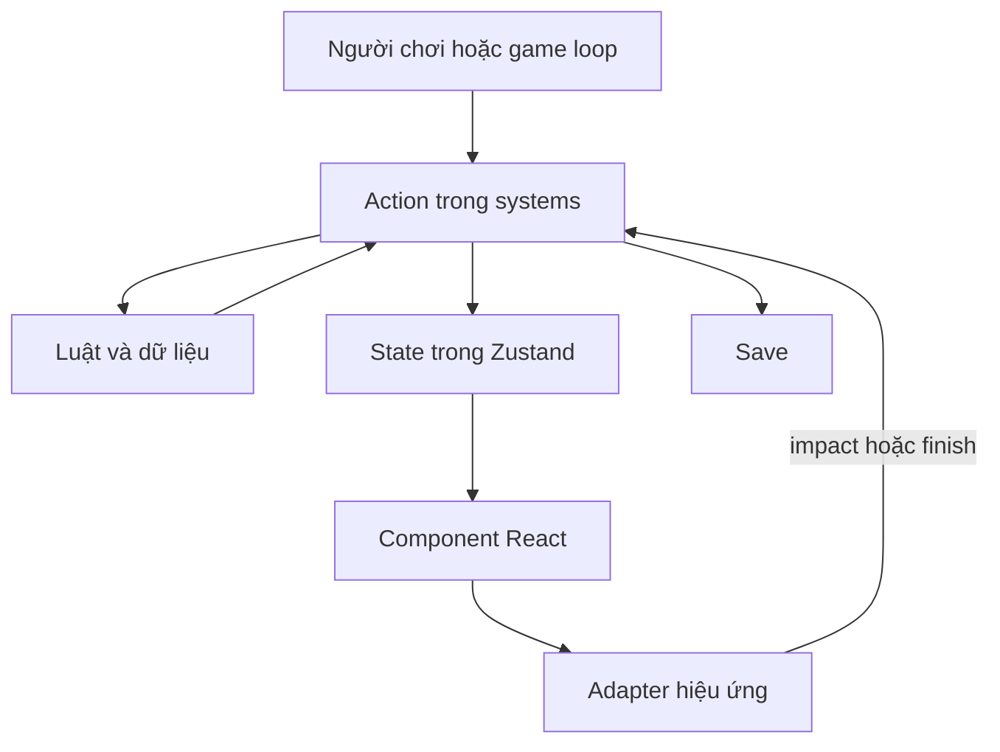

# Học làm webgame từ dự án Poké’Catch

Tài liệu dành cho người bắt đầu, dùng chính mã nguồn dự án làm ví dụ. Cập nhật 16/11/2026. Đọc theo thứ tự; không cần hiểu toàn bộ game trong một lần.

Mục tiêu đầu tiên nên là hiểu được một vòng nhỏ: **bấm nút → đổi dữ liệu → giao diện đổi → lưu → tải lại vẫn đúng**. Sau đó mới ghép thành chiến đấu và tiến trình.

## 1. Chạy game và biết mình đang nhìn gì

Mở terminal trong thư mục dự án:

```powershell
npm install
npm run dev
```

Mở địa chỉ Vite in ra trong terminal. Giữ terminal chạy để trình duyệt nhận thay đổi khi lưu file. `Ctrl+C` dừng server do mình mở.

Các lệnh còn lại:

| Lệnh | Dùng khi nào |
|---|---|
| `npm test` | Kiểm tra công thức, store, runtime và dữ liệu |
| `npm run build` | Kiểm tra TypeScript và tạo bản phát hành trong `dist` |
| `npm run audit:chapters -- --strict` | Bắt dữ liệu chapter không hợp lệ |
| `npm run assets:sync` | Đồng bộ sprite theo cấu trúc asset của dự án |
| `npm run reference:check` | So phiên bản nguồn moves/FX với metadata; không tự cập nhật toàn game |

Không cần học build tool ngay. Trước hết sửa một đoạn chữ trong component, lưu file và quan sát trình duyệt.

**Bài tập:** đổi một câu giới thiệu trong `StarterSelection.tsx`, xem kết quả bằng profile trình duyệt thử riêng. Không xóa save đang chơi để thử.

## 2. Sáu khái niệm nền tảng

| Khái niệm | Hiểu đơn giản | Ví dụ trong game |
|---|---|---|
| HTML/JSX | Những phần tử xuất hiện trên trang | Nút chọn Squirtle |
| CSS | Cách phần tử được vẽ và sắp xếp | Vị trí sprite, viền, màu, chuyển động |
| JavaScript | Các bước xử lý | Bấm chọn → ghi lựa chọn |
| TypeScript | JavaScript có mô tả kiểu dữ liệu | `number`, `PokemonInstance`, `StepNode` |
| React | Dựng giao diện từ dữ liệu hiện tại | HP thay đổi → thanh máu đổi |
| Zustand | Nơi nhiều component cùng đọc và sửa state | Team, Arena, PC cùng thấy một Pokémon |

JSX gần giống HTML nhưng nằm trong TypeScript. Trong JSX, `{...}` là nơi chèn giá trị hoặc biểu thức JavaScript:

```tsx
const name = 'Squirtle';
return <button>Choose {name}</button>;
```

`number | null` nghĩa là có một số, hoặc chưa có lựa chọn. Vì vậy `selected === null` là điều kiện hợp lý để khóa nút xác nhận; đừng dùng một số giả để biểu diễn chưa chọn.

Array là một danh sách; object là một nhóm trường. Một đội hình là array các object Pokémon. `map` tạo danh sách mới từ danh sách cũ; `filter` giữ những phần tử thỏa điều kiện; `find` tìm một phần tử.

**Bài tập:** mở `src/types/game.ts`, tìm `PokemonInstance`. Ghi ra trường nào là số, trường nào là chuỗi và trường nào có thể không tồn tại.

## 3. Bản đồ mã nguồn nên đọc

```text
src/main.tsx                    Khởi động React, nạp CSS
src/App.tsx                     Ghép màn hình và nối hành động điều hướng
src/components/                 Giao diện
src/data/                       Dữ liệu loài, template, JSON trích nguồn
src/types/game.ts               Các kiểu dữ liệu dùng chung
src/store/useGameStore.ts       Ghép state/actions, load và save
src/game/domain/                Luật/công thức, không phụ thuộc DOM
src/game/data/                  Generator và selector chapter
src/game/runtime/               Đồng hồ, khóa, timer, vòng chạy
src/game/systems/               Battle, capture, rewards, encounter
src/game/presentation/          Cầu nối runtime với hiệu ứng
src/styles/                     CSS nguồn đã scope và adapter
public/assets/                  Tài nguyên trình duyệt có thể tải
scripts/                        Công cụ trích/đồng bộ/audit
tests/                          Kiểm tra tự động
docs/                           Báo cáo, nguồn, giới hạn và hướng dẫn
```

Thứ tự đọc dễ hơn việc mở file lớn nhất: `StarterSelection.tsx` → `PokemonArt.tsx` → kiểu Pokémon → action `chooseStarter` → selector chapter → `encounter.ts` → `battle.ts` → runtime và adapter hiệu ứng.

## 4. Dữ liệu, luật chơi và hình ảnh là ba phần khác nhau

Ví dụ một đòn đánh:

1. Dữ liệu nói move thuộc hệ gì, power bao nhiêu.
2. Luật tính đòn có trúng không và gây bao nhiêu damage.
3. Runtime tạo yêu cầu tấn công, giữ khóa lượt.
4. Presentation vẽ chuyển động, báo lúc chạm mục tiêu.
5. Store trừ HP và cập nhật giao diện.



Nếu mỗi component tự tính damage hoặc tự chọn Pokémon gặp, các màn sẽ lệch nhau. Trong dự án, Arena và Found here phải đọc cùng selector để Pokémon đang gặp đúng với bảng tỷ lệ bên phải.

## 5. State: sự thật hiện tại của game

`useGameStore` chứa party, PC, chapter, HP, inventory và trạng thái hiệu ứng. Component nên đọc đúng phần nó cần:

```tsx
const trainerName = useGameStore(state => state.trainerName);
```

Một action là hàm thay đổi state theo luật. Ví dụ `chooseStarter` kiểm tra đã chọn chưa trước khi tạo Pokémon. Nhờ vậy bấm hai lần không tạo hai starter.

Khi cập nhật object/array, tạo bản mới để React/Zustand nhận ra thay đổi:

```ts
// Ví dụ minh họa, không phải action mới cần thêm vào dự án.
const updated = party.map(mon =>
  mon.uid === targetUid ? { ...mon, currentHp: nextHp } : mon
);
```

`speciesId` là loài; `uid` là cá thể. Hai Pikachu có cùng speciesId nhưng uid khác nhau. Team preset nên lưu uid, không sao chép cả Pokémon; nếu copy object, hai đội có thể giữ hai bản HP/EXP khác nhau của cùng một cá thể.

**Bài tập:** tìm `partyPresets` và giải thích vì sao chuyển preset không được tạo Pokémon mới.

## 6. Dùng state machine để quản lý các chặng

State machine là danh sách trạng thái và những đường chuyển được phép. Onboarding có các chặng:

```text
title → intro → avatar → name → welcome → starter → leaving
```

Ở `name`, nhấn Confirm chỉ được đi tiếp nếu tên sau `trim()` không rỗng. Ở `starter`, bấm Pokémon chỉ đổi preview. Ở `leaving`, hiệu ứng chạy xong mới gọi action commit.

So với nhiều biến `isX`, một biến stage giúp tránh các tình huống vừa hiện màn tên vừa cho đánh nhau. Trong battle còn cần phase, operation key và encounter ID vì timer/hiệu ứng có thể hoàn thành muộn.

**Bài tập:** vẽ luồng `battle → KO → capture → reward → next node`. Ghi rõ chặng nào được đổi node và chặng nào phải chờ click Continue.

## 7. Vì sao game cần runtime riêng

`setInterval` chỉ là tín hiệu đến lúc thử làm việc; nó không đảm bảo mọi hiệu ứng trước đã xong. Nếu mỗi nhịp đều đánh ngay, Pokémon có thể đánh khi đang gục hoặc đang được thu vào bóng.

`GameplayRuntime` quản lý encounter, operation, timer và khóa. Ba quy tắc cần nhớ:

- Callback thuộc encounter cũ phải bị bỏ qua sau khi đổi node.
- Một impact hoặc reward chỉ được áp dụng một lần dù callback bị gọi lại.
- Combat chỉ bước tiếp khi đúng phase và hết khóa.

Hãy hình dung callback giữ một số vé. Khi đổi encounter, runtime đổi số vé; callback cũ quay lại sẽ không có quyền sửa trận mới.

Watchdog là đường phục hồi khi renderer không gửi finish. Nó giúp tránh kẹt, nhưng test vẫn phải kiểm tra watchdog không chạy trong luồng bình thường; không coi fallback là bằng chứng hiệu ứng đúng.

## 8. Timing và ×1/×2/×3

Ở dự án này, nút ×3 tương ứng **pace 2,5**, theo hành vi nguồn đã đo. Dùng `gameplaySpeed()` để chuyển UI/save speed thành pace; đừng rải phép chia trực tiếp cho số 3.

Một lượt có thời gian hoạt ảnh tới impact, recovery và khoảng chờ queue. Actor tiếp theo cũng phải tuân thủ các chặng đó. Bỏ recovery của một bên làm cả trận nhanh hơn dù animation riêng trông vẫn đúng.

HP phải trừ tại impact. Nếu đòn hạ đối thủ, đối thủ không được phản đòn. Particle trang trí có thể còn tồn tại sau khi logic đòn đã kết thúc.

Speed được chốt khi bắt đầu một hiệu ứng. Đổi nút tốc độ giữa chừng chỉ áp dụng ở chặng sau; mở Team/PC không được dựng lại Arena rồi phát lại FX.

Buff dùng thời gian thực. Combat không được bù hàng chục đòn chỉ vì tab vừa bị trình duyệt trì hoãn. Đây là hai loại đồng hồ khác nhau.

Đọc thêm: [BATTLE_CADENCE_REVIEW.md](BATTLE_CADENCE_REVIEW.md).

## 9. Animation: CSS, WAAPI và Canvas

| Công cụ | Phù hợp | Cần quản lý |
|---|---|---|
| CSS keyframes | Idle, nhún, nền sao, chữ bay | Class, thời lượng, transform origin |
| Web Animations API | Chuỗi chuyển động có điểm bắt đầu/kết thúc | Animation object, cancel, promise bị hủy |
| Canvas | Nhiều hạt, tia sáng, move FX | Vòng vẽ, resize, tọa độ, dọn frame/timer |
| GIF | Artwork Gen5ani có sẵn | Đúng resolver, kích thước, ảnh tĩnh/reduced motion |

Ví dụ CSS minh họa:

```css
@keyframes small-hop {
  50% { transform: translateY(-6px); }
}
```

Đừng cho hai hiệu ứng cùng ghi đè `transform` của một phần tử. Dùng wrapper: cha lo vị trí, con lo lunge, cháu lo idle hoặc flip. Một nguyên nhân bóng lệch trước đây là căn giữa hai lần ở hai lớp.

Trong React, `useEffect` tạo timer thì cleanup phải hủy timer:

```tsx
useEffect(() => {
  const timer = window.setTimeout(finish, 500);
  return () => window.clearTimeout(timer);
}, [finish]);
```

Ví dụ trên chỉ minh họa cleanup; callback trong runtime thực còn cần khóa theo encounter. React StrictMode có thể mount/cleanup lại trong môi trường dev, giúp phát hiện tác dụng phụ bị lặp.

## 10. Sprite: hộp ảnh và phần nhìn thấy khác nhau

PNG nhỏ của dự án có canvas 68×56 nhưng Pokémon chỉ chiếm một phần. Nếu scale theo toàn ảnh, một loài có thể nhìn rất nhỏ; nếu crop sai, chân và bóng lệch.

`spriteBounds.json` lưu phần nhìn thấy. `PokemonSprite` dùng bounds để tạo khung crop và đặt ảnh vào đúng vị trí. Rail/sân dùng tỷ lệ nguyên 1×/2× để giữ pixel rõ; không phóng tùy ý mọi loài lên 3×.

Artwork lớn dùng `PokemonArt`, resolver Gen5ani và metadata riêng. Không lấy icon PC phóng lớn để thay GIF trong modal. Khi người dùng bật reduced motion hoặc ảnh chưa được chọn, component có thể đóng băng artwork thành ảnh tĩnh.

Điểm neo nên là giữa chân Pokémon. Bóng nằm trên mặt đất, độc lập với phần thân đang nhún. Đổi loài cần kiểm tra cả loài thấp, cao, bay và có nhiều khoảng trong suốt.

**Bài tập:** so Bulbasaur, Onix và Zubat trong rail. Giải thích vì sao dùng cùng `width:60px` cho cả ba chưa đủ để nhìn giống nguồn.

## 11. Làm UI giống bản tham chiếu bằng số đo

Đừng bắt đầu bằng đổi hàng chục giá trị CSS. Chọn một viewport, cùng trạng thái game và cùng bước animation rồi đo:

1. Khung ngoài: chiều rộng sidebar, header và khoảng cách giữa cột.
2. Sân: tỷ lệ khung, vị trí và kích thước tại viewport đó.
3. Panel/slot: số hàng, kích thước ô, khoảng cách và phần overflow.
4. Sprite/chữ/HP: căn theo geometry đã đúng.
5. Animation: thời điểm xuất hiện, impact, giữ và biến mất.

CSS nguồn trong dự án được scope để không làm hỏng màn khác. Các file `*-reference.css` được sinh bằng script; phần thích nghi nằm ở adapter. Sửa tay generated CSS có thể mất ở lần chạy script sau.

Font khác cũng làm thay đổi chiều rộng nút và cách xuống dòng. Luôn kiểm tra font đã tải trước khi kết luận lệch vị trí.

Modal portal có thể nằm ngoài `.game-shell`; vì vậy CSS chỉ bắt đầu bằng `.game-shell .pokemon-art` sẽ không áp dụng cho nó. Đây là lỗi phạm vi selector, không phải lỗi tải GIF.

## 12. Sinh chapter từ template và seed

Template mô tả cấu trúc: route, khoảng level, số lượt gặp, trainer, quà, Gym. Generator biến cấu trúc đó thành danh sách node thực tế.

Nếu dùng `Math.random()` lại mỗi lần render hoặc reload, trainer và tổng bước có thể đổi ngay dưới currentStep. Vì vậy một run có seed và snapshot các điều kiện cần thiết.

```ts
// Có thể tra các hàm này trong src/game/data/chapterGenerator.ts.
const run = defaultChapterRun('kanto-2');
const steps = generateChapterSteps('kanto-2', run);
```

Cùng input phải cho cùng output. `chapterRandom(seed)` cung cấp RNG có thể tái hiện. Khi debug lỗi ở một bước, giữ seed thay vì thử ngẫu nhiên đến khi gặp lại.

Node giữ source để truy lại template. `currentChapter(state)` lấy đúng mảng node của run đang chơi. Không lấy `ALL_CHAPTERS` preview mặc định để quyết định kết thúc run có số node khác.

`completedChapters` tách khỏi badge: có 14 chương nhưng chỉ tám huy hiệu Gym. League không được mượn Earth Badge để giả lập hoàn tất hoặc mở tất cả chương.

Đọc thêm: [R04_2_KANTO_RUNTIME.md](R04_2_KANTO_RUNTIME.md).

## 13. Tỷ lệ xuất hiện và trọng số

Một pool có trọng số 70, 25, 5 không phải ba lần tung độc lập. Tổng là 100; chọn một điểm trên đoạn tổng rồi tìm Pokémon chứa điểm đó.

Nếu buff nhân đôi trọng số nhóm hiếm, phải tính lại tổng. Không thể chỉ nhân phần trăm hiển thị rồi giữ nguyên các số khác, vì tổng sẽ vượt 100%.

Encounter và Found here phải dùng cùng điều kiện buổi/thời tiết/buff. Có dữ liệu cho trời mưa không đồng nghĩa hệ thống tự chuyển thời tiết đã hoàn chỉnh; cần phân biệt dữ liệu hỗ trợ với cơ chế đã nối.

**Bài tập:** với trọng số `[70,25,5]`, nhân đôi riêng trọng số 5. Tính ba phần trăm mới bằng cách chia cho tổng 105.

## 14. Save đúng quan trọng hơn chỉ gọi JSON.stringify

Save ghi dữ liệu cần tiếp tục: Pokémon, chapterRun, currentStep, inventory, badge, quà đã nhận và checkpoint. Không lưu DOM, timer hoặc callback vào JSON.

Khi load phải kiểm tra kiểu và phạm vi. JSON đọc được chưa chắc là dữ liệu hợp lệ: HP có thể âm, species ngoài 151, level sai hoặc checkpoint trỏ node không còn tồn tại.

Thứ tự tốt khi phát thưởng: xác nhận chưa nhận → cập nhật Pokémon/tiền/receipt → ghi resolved/checkpoint → save → mới chuyển bước. Nếu chuyển bước trước rồi mới save, refresh ở giữa có thể mất thưởng; nếu không có receipt, refresh có thể nhận lại.

Key hiện tại là `pokecatch_save_v1`; persist version 2 / saveVersion 4. Đừng đổi key/version chỉ để thử UI và đừng thêm reset mỗi lần load. Profile thử riêng là cách xem màn khởi đầu mà không làm mất tiến trình.

Tên người dùng được render bằng React text. Không ghép nó thành HTML dùng `innerHTML`, vì chuỗi người dùng có thể chứa ký tự đặc biệt.

## 15. Kiểm tra theo lỗi thật

Core test chạy nhanh và không cần nhìn màn hình. Dùng nó để chứng minh công thức, điều kiện mở, tính xác định của generator và thưởng một lần. Browser test chứng minh các lớp kết hợp được: nút click được, ảnh đúng nguồn, modal giữ focus, scene và animation không chặn nhau.

Một bộ test cần có cả đường thành công lẫn tình huống dễ hỏng:

- Đối thủ về 0 HP trước lượt phản công.
- Đổi node khi callback cũ chưa xong.
- Nhấn xác nhận hai lần.
- Reload trước và sau khi nhận quà.
- Đổi tốc độ giữa hiệu ứng.
- Mở Team/PC giữa trận rồi quay lại.

Không dùng test mirror chỉ chép lại thuật toán rồi so hai bản giống nhau. Test pool Kanto đối chiếu dữ liệu native đã thu; test walkthrough kiểm tra đường chơi và trạng thái cuối. Đội Lv.100 đi hết League chứng minh đường runtime thông, không chứng minh độ khó hay EXP tự nhiên đúng.

## 16. Cách sửa một lỗi mà không tốn nhiều vòng

1. Viết rõ thao tác tái hiện, viewport, chapter/node và speed.
2. Khoanh vùng: data, logic, timing hay CSS.
3. Đọc đúng component/action/selector liên quan; tránh mở toàn bundle hoặc JSON lớn.
4. Sửa một nguyên nhân cụ thể và xem lại ca lỗi.
5. Chạy nhóm test phù hợp; build khi thay production.
6. Ghi kết quả thật và điều chưa đo vào report, cập nhật handoff.

Ví dụ sprite modal lớn quá: kiểm tra `PokemonArt size`, scale của wrapper và bounds trước. Chưa có lý do đổi cả bộ GIF hoặc công thức battle.

Ví dụ đánh nhanh quá: đo attack-start đến actor kế tiếp, so impact/recovery/queue. Tăng bừa mọi duration có thể làm particle chậm nhưng lượt vẫn sai.

## 17. Lộ trình tự học bằng bài nhỏ

| Bài | Làm gì | Dấu hiệu đã hiểu |
|---|---|---|
| 1 | Đổi chữ, màu, khoảng cách một nút | Biết JSX và CSS nào đang áp dụng |
| 2 | Viết component đếm số bằng useState | Bấm nút đổi state, không sửa DOM trực tiếp |
| 3 | Vẽ một thẻ từ object Pokémon mẫu | Tách dữ liệu khỏi markup |
| 4 | Đọc/ghi một trường hồ sơ bằng store | Các component cập nhật cùng dữ liệu |
| 5 | Làm idle/hop có reduced motion | Hiểu wrapper, pivot và cleanup |
| 6 | Thêm test cho thao tác lặp | Biết kiểm tra tính một lần |
| 7 | Sinh route nhỏ từ seed riêng | Reload không đổi kế hoạch |
| 8 | Đo một màn desktop/mobile | Có số đo/ảnh, không chỉ cảm giác |

Thực hành trong branch hoặc bản sao riêng. Trước khi thay cấu trúc save/runtime, đọc test hiện có và xác định dữ liệu nào phải giữ tương thích.

## 18. Những gì chưa nên hiểu nhầm là đã xong

Dự án đã có nền runtime, 151 loài Kanto, 14 chương, collection và nhiều FX, nhưng chưa phải bản sao hoàn chỉnh mọi vùng. Onboarding mới dùng CSS nguồn và hiệu ứng viết lại; cinematic/SFX, một số chiêu trạng thái, tiến hóa sở hữu, Shop, hoạt động phụ và cơ chế vùng mới còn cần tiếp tục theo report.

Tài liệu kỹ thuật tốt ghi rõ giới hạn. Một test xanh hoặc một ảnh giống không tự chứng minh toàn game đạt 100%.

Khi tiếp tục dự án, mở [AI_HANDOFF.md](AI_HANDOFF.md), rồi đến đúng báo cáo liên quan. Dùng tài liệu này để hiểu nguyên lý; dùng code/test hiện tại để xác nhận hành vi cụ thể.
